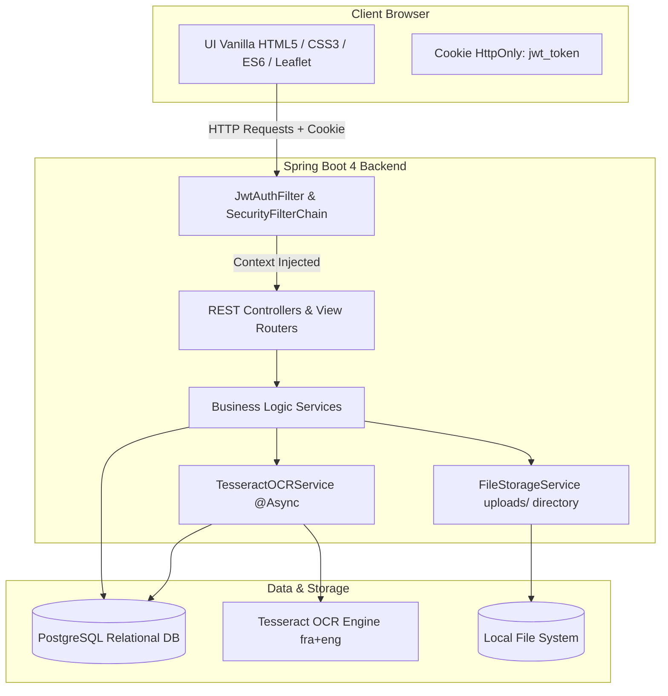
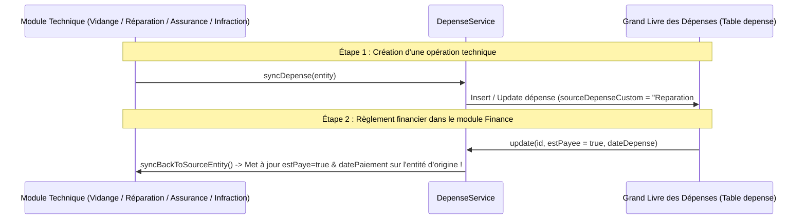

# 🚗 ParcVision — Plateforme Intégrale de Gestion de Flotte Automobile & GED Intelligente (OCR)

[](https://www.oracle.com/java/)
[](https://spring.io/projects/spring-boot)
[](https://www.postgresql.org/)
[](https://github.com/tesseract-ocr/tesseract)
[](https://leafletjs.com/)
[](https://getbootstrap.com/)
[](https://jwt.io/)

---

## 📑 Table des Matières

1. [Vue d'Ensemble & Vision du Projet](#-vue-densemble--vision-du-projet)
2. [Architecture Système & Sécurité](#-architecture-système--sécurité)
3. [Rapport Détaillé de l'Ensemble des Fonctionnalités](#-rapport-détaillé-de-lensemble-des-fonctionnalités)
   - [Module 1 : Authentification, Multi-Tenancy & Sécurité](#module-1--authentification-multi-tenancy--sécurité)
   - [Module 2 : Tableau de Bord Exécutif & KPI en Temps Réel](#module-2--tableau-de-bord-exécutif--kpi-en-temps-réel)
   - [Module 3 : Gestion du Parc de Véhicules](#module-3--gestion-du-parc-de-véhicules)
   - [Module 4 : Gestion des Conducteurs & Ressources Humaines](#module-4--gestion-des-conducteurs--ressources-humaines)
   - [Module 5 : Ordres de Mission, Suivi des Colis & Télémétrie GPS](#module-5--ordres-de-mission-suivi-des-colis--télémétrie-gps)
   - [Module 6 : Maintenance Proactive, Pannes & Gestion des Accidents](#module-6--maintenance-proactive-pannes--gestion-des-accidents)
   - [Module 7 : Écosystème Prestataires & Fournisseurs](#module-7--écosystème-prestataires--fournisseurs)
   - [Module 8 : Conformité Réglementaire, Assurances & Infractions](#module-8--conformité-réglementaire-assurances--infractions)
   - [Module 9 : Gestion Financière & Synchronisation Bidirectionnelle des Dépenses](#module-9--gestion-financière--synchronisation-bidirectionnelle-des-dépenses)
   - [Module 10 : Archivage Électronique (GED) & OCR Intelligent (Tesseract)](#module-10--archivage-électronique-ged--ocr-intelligent-tesseract)
   - [Module 11 : Paramètres du Profil & Image de Marque Entreprise](#module-11--paramètres-du-profil--image-de-marque-entreprise)
   - [Module 12 : Générateur de Données Réalistes (Database Seeder)](#module-12--générateur-de-données-réalistes-database-seeder)
4. [Répertoire des API REST (Endpoints)](#-répertoire-des-api-rest-endpoints)
5. [Stack Technique Complète](#-stack-technique-complète)
6. [Guide d'Installation & Prise en Main Locale](#-guide-dinstallation--prise-en-main-locale)
7. [Données de Test & Comptes de Démonstration](#-données-de-test--comptes-de-démonstration)

---

## 🌟 Vue d'Ensemble & Vision du Projet

**ParcVision** est une solution logicielle d'entreprise nouvelle génération dédiée à la gestion unifiée, intelligente et sécurisée de parcs automobiles et logistiques, couplée à une Gestion Électronique des Documents (GED) dotée d'une Reconnaissance Optique de Caractères (OCR).

Conçu pour répondre aux défis rigoureux des gestionnaires de flottes, transporteurs et entreprises de logistique moderne, ParcVision unifie en un guichet unique :
* Le cycle de vie complet du matériel roulant (véhicules, entretiens, contrôles techniques, assurances).
* Le suivi des conducteurs (disponibilités, permis, conformité administrative).
* Le dispatching et le suivi télématique en temps réel des tournées et livraisons (Leaflet GPS, points de passage, calcul des vitesses et horodatages).
* La maîtrise comptable stricte via un grand livre des dépenses intégrant une **synchronisation bidirectionnelle automatique** entre les paiements et les opérations de terrain.
* L'archivage numérique certifié permettant d'extraire de manière asynchrone le texte contenu dans les pièces scannées (factures, constats, cartes grises, polices d'assurance) et de mener des recherches plein texte instantanées au cœur même des documents.

---

## 🏛 Architecture Système & Sécurité



### Principes Clés d'Ingénierie Logicielle :
1. **Isolation Multi-Entreprise (Multi-Tenancy étanche)** : Chaque utilisateur est rattaché à une `Entreprise`. Toutes les entités opérationnelles (véhicules, conducteurs, missions, interventions, dépenses, dossiers GED) sont filtrées par le contexte de l'entreprise authentifiée, garantissant une étanchéité absolue des données entre clients.
2. **Architecture Stateless Sécurisée par JWT en Cookie HttpOnly** :
   - Émission d'un token JWT crypté avec signature HMAC-SHA256 stocké dans un cookie `HttpOnly`, `SameSite` côté navigateur.
   - Immunité contre les attaques XSS ciblant le vol de jetons dans le `localStorage`.
   - Expiration dynamique : 24 heures en session standard ou 30 jours lors de l'activation de « Se souvenir de moi ».
3. **Protection Intégrée contre le Path Traversal** :
   - Le service `FileController` et le gestionnaire de stockage `FileStorageService` sécurisent la distribution des pièces jointes en vérifiant la résolution canonique (`normalize()`) stricte à l'intérieur de la racine `uploads/`. Tout accès en dehors renvoie un code HTTP 403 Forbidden.
4. **Traitement OCR Asynchrone Haute Performance** :
   - L'extraction OCR Tesseract est déportée dans un pool de threads d'arrière-plan via `@Async`, évitant ainsi tout blocage de requête HTTP lors de l'envoi de fichiers volumineux.
5. **Synchronisation Financière Automatisée & Bidirectionnelle** :
   - Toute création ou mise à jour de facture d'entretien, d'assurance ou de contravention répercute immédiatement un enregistrement dans le grand livre des dépenses. Inversement, l'acquittement d'une dépense met à jour l'entité source d'origine.

---

## 🚀 Rapport Détaillé de l'Ensemble des Fonctionnalités

---

### Module 1 : Authentification, Multi-Tenancy & Sécurité

* **Enregistrement Autonome de l'Entreprise (Onboarding)** :
  - Formulaire d'inscription sécurisé validant l'unicité du nom, de l'email, de l'adresse et du numéro de téléphone de l'entreprise.
  - Contrôle regex strict du format téléphonique marocain : `^(06|07|05)\d{8}$`.
  - Création simultanée de l'entité `Entreprise`, du compte utilisateur principal `Utilisateur` (avec hachage BCrypt du mot de passe) et du profil `Admin`.
  - Initialisation automatique de l'espace de stockage GED racine de l'entreprise (`/`).
* **Gestion d'Accès Basée sur les Rôles (RBAC)** :
  - `ROLE_ADMIN` : Accès intégral à l'ensemble des modules d'administration, de paramétrage, de reporting financier et de configuration d'entreprise.
  - `ROLE_CONDUCTEUR` : Accès dédié au portail conducteur (missions assignées, historique des trajets, déclarations d'incidents, documents personnels).
* **Déconnexion et Clôture de Session Sécurisée** :
  - Endpoint `/api/auth/logout` invalidant immédiatement le cookie sécurisé en réassignant une durée de vie nulle (`Max-Age=0`).

---

### Module 2 : Tableau de Bord Exécutif & KPI en Temps Réel

Le tableau de bord d'administration centralise l'intelligence opérationnelle de la flotte et offre une vue panoramique instantanée :

```text
┌────────────────────────────────────────────────────────────────────────────────────────┐
│                               PARCVISION DASHBOARD                                    │
├───────────────────┬───────────────────┬──────────────────────┬────────────────────────┤
│    VÉHICULES      │   CONDUCTEURS     │       MISSIONS       │      FINANCE FLOTTE    │
│  Total: 24        │  Total: 18        │  En cours: 5         │  Total: 142 850,00 DH  │
│  Disponibles: 16  │  Disponibles: 12  │  Aujourd'hui: 8      │  Espèces: 48 300,00 DH │
│  En mission: 5    │  En mission: 5    │  Complétées: 120     │  Carte Bancaire: 65%   │
│  Maintenance: 3   │  En congé: 1      │                      │                        │
└───────────────────┴───────────────────┴──────────────────────┴────────────────────────┘
```

* **Indicateurs de Disponibilité de la Flotte** :
  - Jauge en direct des véhicules selon leur statut opérationnel (`Disponible`, `En Mission`, `En Maintenance`).
  - Statut des conducteurs d'équipe (`Disponible`, `En Mission`, `En Congé`).
* **Suivi Opérationnel des Tournées** :
  - Nombre total de missions exécutées et compteur de missions actives sur la route.
  - Graphique temporel d'activité : répartition quotidienne du volume de livraisons (`missionsParJour`).
* **Comptabilité & Synthèse Financière** :
  - Dépenses totales cumulées avec ventilation automatique par mode de règlement (Espèces vs Carte Bancaire).
  - Coûts globaux des interventions techniques et ratio payé vs en attente de règlement.
* **Baromètre de Maintenance & Incidentologie** :
  - Compteurs analytiques distincts : Total des vidanges, total des réparations d'atelier, dépannages SOS urgents, accidents déclarés, assurances et infractions.

---

### Module 3 : Gestion du Parc de Véhicules

* **Fiche d'Identité Véhicule Exhaustive** :
  - Marque, modèle, numéro d'immatriculation (compatible avec le format officiel marocain et formats internationaux).
  - Compteur kilométrique actuel mis à jour en continu selon les missions et interventions.
  - Capacité de charge utile déclarée (en kg).
  - Motorisation et carburant (Diesel, Essence, Hybride, Électrique).
  - Date de première mise en circulation.
* **Classification Technique & Statuts** :
  - Types de carrosseries : `CAMION`, `FOURGONNETTE`, `VOITURE`, `POIDS_LOURD`, etc.
  - Cycle de vie opérationnel : `DISPONIBLE`, `EN_MISSION`, `EN_MAINTENANCE`, `PANNE`.
* **Échéancier Légal & Alertes Administratives** :
  - Suivi de la date d'expiration de la police d'assurance avec mise à jour automatisée lors de la souscription d'une nouvelle attestation.
  - Suivi de la date du prochain contrôle technique obligatoire avec alertes de dépassement.
* **Galerie Multimédia & Numérisation des Papiers du Véhicule** :
  - **Galerie d'images multiples** : Téléchargement et carrousel de photographies réelles du véhicule sous tous les angles.
  - **Scan de Carte Grise** : Stockage sécurisé et consultation inline du certificat d'immatriculation officiel.
  - **Scan d'Attestation d'Assurance** : Consultation instantanée de la police d'assurance active.
* **Outils Avancés de Filtrage** :
  - Recherche instantanée par immatriculation, marque ou modèle.
  - Filtre dynamique par statut de disponibilité.
  - Pagination côté serveur haute vélocité (`Spring Data JPA Pageable`).

---

### Module 4 : Gestion des Conducteurs & Ressources Humaines

* **Dossier Personnel du Chauffeur** :
  - Liaison 1:1 avec le compte d'authentification utilisateur (`Utilisateur`).
  - Identité complète : Nom, prénom, date de naissance, adresse email, téléphone direct.
  - Numéro de Carte d'Identité Nationale (CIN) et date d'embauche au sein de la société.
* **Permis de Conduire & Conformité Réglementaire** :
  - Numéro officiel de permis de conduire (indexé avec contrainte d'unicité).
  - Date de validité du permis avec détection préventive des dates d'expiration.
* **Cycle d'Activité Conducteur** :
  - Statuts d'affectation : `DISPONIBLE`, `EN_MISSION`, `EN_CONGE`.
* **Portefeuille Documentaire Numérique** :
  - Photo de profil du chauffeur (avatar affiché sur les fiches de mission et la barre de navigation).
  - Scan haute définition de la CIN (recto-verso).
  - Scan haute définition du permis de conduire.
* **Attribution Intelligente** :
  - Le système empêche l'assignation d'un conducteur à un ordre de mission s'il n'est pas dans l'état `DISPONIBLE`.

---

### Module 5 : Ordres de Mission, Suivi des Colis & Télémétrie GPS

* **Planification Complète des Trajets** :
  - Génération d'une référence unique de mission (ex: `MIS-2026-X892`).
  - Adresse précise de départ et adresse de destination finale.
  - Date et heure prévues de départ, date et heure estimées de fin.
  - Horodatage certifié de fin de mission réelle lors du déchargement.
  - Instructions spéciales pour le transporteur (accès quai, contacts destinataire, consignes de livraison).
* **Vérification d'Affectation Véhicule / Conducteur** :
  - Menu de sélection dynamique présentant uniquement les véhicules et conducteurs libres au moment de la planification.
  - Basculement instantané des statuts du véhicule (`EN_MISSION`) et du chauffeur (`EN_MISSION`) dès la validation de la mission.
* **Gestion et Traçabilité des Colis Embarqués (`Colis`)** :
  - Description de la cargaison et code de suivi unique (Barcode / Tracking ID).
  - Poids unitaire (kg) et volume (m³).
  - Catégorisation du fret : `STANDARD`, `FRAGILE`, `VOLUMINEUX`, `PERISSABLE`, `DANGEREUX`.
* **Intégration Matérielle & Boîtiers IoT / Télématique** :
  - Prise en charge des trackers embarqués : enregistrement du `tracker_id`, de l'IMEI du boîtier et du numéro de carte SIM M2M.
  - Bouton d'activation/désactivation du suivi GPS en direct (`isGpsEnabled`).
  - Endpoint d'ingestion externe `/api/missions/{id}/tracker/location` pour alimenter les coordonnées depuis un boîtier GPS ou smartphone conducteur.
* **Visualisation Cartographique Interactive (Leaflet.js & OpenStreetMap)** :
  - Tracé dynamique de la trajectoire routière complète à partir des coordonnées GPS enregistrées (`PointGPS`).
  - Marqueurs distinctifs avec icônes personnalisées : Départ (vert), Points de passage en cours de route (bleu), Arrivée effective (rouge).
  - Données télémétriques associées à chaque point : Latitude, longitude, horodatage précis, vitesse instantanée en km/h et précision du signal GPS en mètres (`precisionGps`).
* **Clôture de Mission & Preuve Numérique de Livraison (PoD)** :
  - Téléchargement et archivage de la photo ou du document de décharge client (`preuveLivraisonUrl`).
  - Libération automatique du véhicule et du conducteur (`DISPONIBLE`) dès la clôture de la mission.

---

### Module 6 : Maintenance Proactive, Pannes & Gestion des Accidents

Toutes les interventions techniques héritent de l'entité polymorphique `Intervention` (stratégie JPA `InheritanceType.JOINED`) et partagent un socle commun : véhicule cible, prestataire tiers (`Fournisseur`), date d'intervention, kilométrage du véhicule, description de la panne, actions menées et coût total engagé.

#### A. Vidanges & Entretien Périodique (`Vidange`)
* Suivi précis du lubrifiant moteur : type d'huile et indice de viscosité (ex: `5W-30 Synthese`, `10W-40`).
* Contrôle triple filtre :
  - Remplacement du filtre à huile (`filterHuileChange`).
  - Remplacement du filtre à air (`filterAirChange`).
  - Remplacement du filtre à carburant (`filterCarburantChange`).
* Suivi de règlement : statut payé/non payé (`estPaye`) et date d'acquittement.

#### B. Réparations d'Atelier & Mécanique Générale (`Reparation`)
* Nomenclature détaillée des pièces mécaniques ou électroniques remplacées.
* Association avec un garage partenaire référencé dans l'annuaire des fournisseurs.
* États d'avancement du chantier : `En attente`, `En cours`, `Terminée`.
* Émargement financier : coût facturé, état de paiement et date de liquidation.

#### C. Dépannages d'Urgence & SOS Remorquage (`Depannage`)
* Enregistrement du lieu exact de l'incident routier (autoroute, route nationale, agglomération).
* Indicateur booléen d'obligation de remorquage sur plateau (`necessiteRemorquage`).
* Identification du dépanneur externe intervenant en urgence.
* Bilan technique et coût de l'assistance routière d'urgence.

#### D. Sinistres, Collisions & Gestion des Accidents (`Accident`)
* Circonstances de l'accident : lieu géographique, récit contextuel de l'accrochage, conducteur au volant.
* Évaluation de la gravité du choc : `Légère`, `Moyenne`, `Grave`.
* État de gestion de l'incident : `Déclaré`, `En expertise assurance`, `En réparation`, `Clôturé`.
* Estimation budgétaire des dégâts et devis de carrosserie (`budgetEstime`).
* **Galerie de Photographies du Sinistre (`accident_photos`)** :
  - Enregistrement de multiples photographies de l'accident (dégâts du véhicule, constat amiable, environnement du choc) via `@ElementCollection`.
  - Affichage plein écran et zoom pour expertises internes.

---

### Module 7 : Écosystème Prestataires & Fournisseurs

* **Annuaire B2B Spécialisé** :
  - Catégorisation des partenaires : `Garage / Atelier Mécanique`, `Station-Service / Gazole`, `Fournisseur de Pièces de Rechange`, `Société de Remorquage SOS`.
  - Raison sociale, ville d'implantation, adresse physique complète et contact téléphonique direct.
* **Intégration Transversale dans la Maintenance** :
  - Sélection assistée du fournisseur lors de la saisie d'une vidange, d'une réparation ou d'un dépannage.
* **Suppression Sécurisée sans Perte d'Historique** :
  - En cas de suppression d'un fournisseur, le service applique un détachement gracieux (`fournisseur_id = null`) sur les anciennes interventions, préservant ainsi l'intégrité comptable et l'historique d'atelier du véhicule.

---

### Module 8 : Conformité Réglementaire, Assurances & Infractions

#### A. Polices d'Assurance Véhicule (`Assurance`)
* Formules de couverture : `Tous risques`, `Responsabilité Civile (Tiers simple)`, `Tierce Collision`.
* Nom de la compagnie d'assurance (ex: AXA, Wafa Assurance, RMA Watanya, Sanlam, AtlantaSanad).
* Période couverte : date de début, date d'échéance et durée en mois.
* Montant de la prime annuelle et état de paiement.
* **Mise à jour automatique de la flotte** : La date de fin de la police met à jour instantanément le champ `dateExpirationAssurance` de la fiche véhicule.
* Document numérique : upload et consultation directe du scan de l'attestation d'assurance.

#### B. Gestion des Infractions Routières & Amendes (`Infraction`)
* Typologie des contraventions : `Excès de vitesse`, `Stationnement interdit`, `Franchissement de feu rouge`, `Défaut de contrôle technique`, etc.
* Traçabilité croisée multi-entités : association directe de l'infraction avec le **véhicule**, le **conducteur fautif** et la **mission** au cours de laquelle l'événement s'est produit.
* Gestion des délais de rigueur : date de commission de l'infraction et date limite de paiement pour éviter les majorations légales.
* Montant de l'amende, enregistrement du reçu de paiement et indicateur `estPayee`.
* Pièce justificative : upload du procès-verbal (PV) ou de l'avis de contravention scanné.

---

### Module 9 : Gestion Financière & Synchronisation Bidirectionnelle des Dépenses

Le module financier centralise dans l'entité `Depense` l'ensemble des flux monétaires sortants de l'entreprise.



* **Sources de Dépenses Prises en Compte** :
  - Vidanges d'entretien régulier.
  - Réparations d'ateliers et pièces détachées.
  - Dépannages et remorquages autoroutiers.
  - Primes d'assurances de la flotte.
  - Amendes et contraventions du code de la route.
  - Dépenses opérationnelles libres (carburant ponctuel, péages, lavage, etc.).
* **Modes de Règlement Gérés** :
  - Espèces (`ESPECES`).
  - Carte bancaire d'entreprise (`CARTE`).
  - Virement ou chèque bancaire.
* **Synchronisation Bidirectionnelle Réactive (Feature Clé)** :
  1. **Sens Métier ➔ Finance** : Dès qu'une vidange, réparation, assurance ou infraction est créée ou éditée, `DepenseService` crée ou actualise la ligne de dépense avec le montant, le tiers bénéficiaire et une référence d'accroche (`ex: Vidange #42`).
  2. **Sens Finance ➔ Métier** : Dès qu'un comptable coche la case "Payé" sur une dépense dans la vue financière, le système extrait l'identifiant source et va marquer automatiquement la facture d'origine comme réglée avec la date de paiement correspondante.
  3. **Suppression en Cascade Intelligente** : La suppression d'une intervention ou d'une contravention purge automatiquement sa ligne de dépense correspondante dans le grand livre.

---

### Module 10 : Archivage Électronique (GED) & OCR Intelligent (Tesseract)

Le module de Gestion Électronique des Documents fournit une infrastructure de coffre-fort numérique virtuel pour l'ensemble des documents légaux et administratifs de la flotte.

```text
[ Racine Entreprise: / ]
├── 📁 Véhicules
│   ├── 📁 12345-A-26 (Dacia Dokker)
│   │   ├── 📄 Carte_Grise.pdf (OCR Indexé)
│   │   └── 📄 Visite_Technique_2026.png (OCR Indexé)
├── 📁 Factures & Maintenance
│   ├── 📄 Facture_Vidange_Castrol_FEV.jpg [Texte extrait par OCR détecté]
└── 📁 Conducteurs
    └── 📁 Ahmed_El_Amrani
        ├── 📄 Permis_Conduire_Recto.png
        └── 📄 CIN_Numérisée.png
```

* **Arborescence Virtuelle de Dossiers** :
  - Création automatique du dossier racine (`/`) dédié à l'entreprise dès l'inscription.
  - Création de répertoires et sous-répertoires imbriqués à l'infini avec calcul dynamique du chemin d'accès (`chemin`).
  - Renommage et suppression sécurisée des répertoires (avec suppression en cascade des sous-dossiers et fichiers).
  - Tri multi-critères : par nom de dossier, par date de création, ascendant ou descendant.
* **Moteur d'Ingestion & Stockage Documentaire** :
  - Dépôt par lot de plusieurs fichiers simultanément (`MultipartFile[]`).
  - Prise en charge universelle : Fichiers images (`JPG`, `PNG`, `TIFF`, etc.) et documents scannés (`PDF`).
  - Extraction automatique du type MIME, de la taille en octets et de la date d'enregistrement.
  - Streaming direct en ligne pour prévisualisation immédiate dans le navigateur (`inline disposition`).
* **Moteur OCR Tesseract Asynchrone (Tess4J)** :
  - L'upload déclenche immédiatement la tâche d'arrière-plan non bloquante `processOCRAsync(documentId)`.
  - Modèles linguistiques combinés : Français + Anglais (`fra+eng`).
  - Stockage du texte brut transcrit dans la colonne PostgreSQL `ocr_content`.
* **Moteur de Recherche Globale & Contextualisation des Résultats** :
  - L'endpoint `/api/archivage/search?q={terme}` effectue une recherche plein texte simultanée sur le **nom du document** ET sur le **texte extrait par OCR**.
  - **Mise en évidence contextuelle** : Pour chaque document trouvé via son texte OCR, le système extrait l'extrait de phrase environnant (`snippet`) et surligne le mot-clé recherché, permettant à l'utilisateur de retrouver instantanément la pièce comptable contenant un numéro de châssis, un montant ou une référence sans même ouvrir le fichier.

---

### Module 11 : Paramètres du Profil & Image de Marque Entreprise

* **Profil de l'Administrateur** :
  - Consultation et mise à jour des informations de contact (nom, prénom, numéro de téléphone, email).
  - Changement de mot de passe sécurisé : vérification préalable de l'ancien mot de passe en base avant application du nouveau hash BCrypt.
  - Téléchargement et découpage de la photo de profil personnelle.
* **Profil Légal de l'Entreprise** :
  - Mise à jour de la raison sociale, de l'email officiel, du téléphone standard et de l'adresse du siège social.
  - Modification du secteur d'activité (Transport de marchandises, BTP, Logistique express, Agroalimentaire, etc.) et de la date de création.
  - **Téléchargement du Logo Officiel de l'Entreprise** : Le logo est directement injecté sur le tableau de bord et dans l'en-tête de toutes les pages d'administration.

---

### Module 12 : Générateur de Données Réalistes (Database Seeder)

Le système intègre un composant de démarrage `DatabaseSeeder.java` basé sur la bibliothèque `JavaFaker` configurée en locale française (`Locale("fr")`) afin d'initialiser immédiatement un environnement opérationnel complet :

* **Contexte Géographique et Économique Marocain** :
  - Entreprises de démonstration avec adresses réelles à Casablanca, Rabat, Tanger et Marrakech.
  - Numéros de téléphone marocains conformes (`06...`, `07...`, `05...`).
  - Répertoire de compagnies d'assurance marocaines (Wafa Assurance, AXA Maroc, RMA Watanya, Sanlam, AtlantaSanad).
  - Immatriculations de véhicules réalistes.
* **Génération de Missions avec Tracés GPS Réalistes** :
  - Simulation de trajets routiers authentiques (ex: Casablanca vers Rabat, Tanger vers Casablanca).
  - Génération de séries ordonnées de `PointGPS` espacés dans le temps avec simulation de vitesse autoroutière (entre 40 et 90 km/h) et horodatages progressifs.
* **Arborescence GED Préconfigurée** :
  - Initialisation automatique des dossiers d'archives pour chaque entreprise enregistrée.

---

## 🔌 Répertoire des API REST (Endpoints)

| Module | Méthode | Endpoint URI | Description |
| :--- | :---: | :--- | :--- |
| **Auth** | `POST` | `/api/auth/login` | Authentification utilisateur & génération du cookie JWT |
| **Auth** | `POST` | `/api/auth/logout` | Déconnexion & révocation du cookie de session |
| **Registration** | `POST` | `/api/registration` | Création de compte entreprise & admin par défaut |
| **Dashboard** | `GET` | `/api/dashboard/stats` | Extraction de tous les KPI chiffrés et graphiques |
| **Véhicules** | `GET` | `/api/vehicules` | Liste paginée avec recherche plein texte & filtre statut |
| **Véhicules** | `POST` | `/api/vehicules` | Enregistrement d'un véhicule avec photos & scans |
| **Véhicules** | `PUT` | `/api/vehicules/{id}` | Mise à jour des informations et pièces d'un véhicule |
| **Véhicules** | `DELETE` | `/api/vehicules/{id}` | Archivage / suppression d'un véhicule |
| **Véhicules** | `GET` | `/api/vehicules/stats` | Compteurs synthétiques (Total, Disponible, Mission, Maintenance) |
| **Conducteurs** | `GET` | `/api/conducteurs` | Liste paginée des conducteurs avec recherche et filtres |
| **Conducteurs** | `POST` | `/api/conducteurs` | Création d'un conducteur avec compte d'accès et scans CIN/Permis |
| **Conducteurs** | `PUT` | `/api/conducteurs/{id}` | Mise à jour d'un conducteur et remplacement de ses fichiers |
| **Conducteurs** | `DELETE` | `/api/conducteurs/{id}` | Suppression du conducteur et de son compte utilisateur lié |
| **Conducteurs** | `GET` | `/api/conducteurs/stats` | Compteurs (Total, Disponible, Mission, Congé) |
| **Missions** | `GET` | `/api/missions` | Liste paginée des missions filtrée par statut et mot-clé |
| **Missions** | `POST` | `/api/missions` | Création d'une mission avec colis, véhicule et conducteur |
| **Missions** | `PUT` | `/api/missions/{id}` | Modification intégrale des paramètres d'une mission |
| **Missions** | `PATCH` | `/api/missions/{id}/status` | Changement d'état (`EN_COURS`, `TERMINEE`, `ANNULEE`) |
| **Missions** | `DELETE` | `/api/missions/{id}` | Suppression d'un ordre de mission |
| **Missions GPS** | `GET` | `/api/missions/{id}/points` | Récupération de tous les points GPS pour tracé Leaflet |
| **Missions GPS** | `POST` | `/api/missions/{id}/tracker/location` | Ingestion d'un point GPS en temps réel depuis boîtier IoT |
| **Vidanges** | `GET` | `/api/vidanges` | Liste paginée des vidanges de l'entreprise |
| **Vidanges** | `POST` | `/api/vidanges` | Enregistrement d'une vidange avec synchronisation comptable |
| **Vidanges** | `PUT` | `/api/vidanges/{id}` | Modification d'une vidange |
| **Vidanges** | `DELETE` | `/api/vidanges/{id}` | Suppression d'une vidange et de sa dépense liée |
| **Réparations** | `GET` | `/api/reparations` | Liste paginée des réparations de la flotte |
| **Réparations** | `POST` | `/api/reparations` | Création d'un ordre de réparation |
| **Réparations** | `PUT` | `/api/reparations/{id}` | Mise à jour de la réparation et des pièces remplacées |
| **Réparations** | `DELETE` | `/api/reparations/{id}` | Suppression d'une réparation et de sa dépense liée |
| **Dépannages** | `GET` | `/api/depannages` | Liste paginée des assistances et dépannages SOS |
| **Dépannages** | `POST` | `/api/depannages` | Saisie d'une intervention de remorquage/dépannage |
| **Dépannages** | `PUT` | `/api/depannages/{id}` | Mise à jour des actions menées et du dépanneur |
| **Dépannages** | `DELETE` | `/api/depannages/{id}` | Suppression d'un dossier de dépannage |
| **Accidents** | `GET` | `/api/accidents` | Liste paginée des déclarations de sinistres et accidents |
| **Accidents** | `POST` | `/api/accidents` | Déclaration d'accident avec upload de photographies multiples |
| **Accidents** | `PUT` | `/api/accidents/{id}` | Actualisation de l'état du sinistre, notes et photos |
| **Fournisseurs** | `GET` | `/api/fournisseurs` | Annuaire des garages, stations et dépanneurs |
| **Fournisseurs** | `POST` | `/api/fournisseurs` | Ajout d'un nouveau partenaire commercial |
| **Fournisseurs** | `PUT` | `/api/fournisseurs/{id}` | Mise à jour des coordonnées d'un fournisseur |
| **Fournisseurs** | `DELETE` | `/api/fournisseurs/{id}` | Suppression d'un fournisseur avec déliaison douce |
| **Assurances** | `GET` | `/api/assurances` | Liste des contrats d'assurance avec alertes d'échéance |
| **Assurances** | `POST` | `/api/assurances` | Enregistrement d'une police avec scan d'attestation |
| **Assurances** | `DELETE` | `/api/assurances/{id}` | Suppression d'une police d'assurance |
| **Infractions** | `GET` | `/api/infractions` | Registre des procès-verbaux et contraventions |
| **Infractions** | `POST` | `/api/infractions` | Déclaration d'une infraction avec scan de l'amende |
| **Infractions** | `DELETE` | `/api/infractions/{id}` | Suppression d'une contravention |
| **Dépenses** | `GET` | `/api/depenses` | Grand livre des dépenses unifiées avec pagination |
| **Dépenses** | `POST` | `/api/depenses` | Création manuelle d'une dépense d'exploitation |
| **Dépenses** | `PUT` | `/api/depenses/{id}` | Mise à jour de dépense avec **rétro-synchronisation d'origine** |
| **Dépenses** | `DELETE` | `/api/depenses/{id}` | Suppression d'une ligne comptable |
| **GED** | `GET` | `/api/archivage/root` | Récupération de l'ID du dossier racine de l'entreprise |
| **GED** | `GET` | `/api/archivage/{id}/dossiers`| Liste des sous-dossiers enfants |
| **GED** | `GET` | `/api/archivage/{id}/documents`| Liste des documents contenus dans un dossier |
| **GED** | `POST` | `/api/archivage/{parentId}/dossiers` | Création d'un sous-dossier virtuel |
| **GED** | `POST` | `/api/archivage/{id}/upload` | Upload multiple de documents & déclenchement de l'OCR |
| **GED** | `GET` | `/api/archivage/search` | **Recherche plein texte globale (Titre + Texte OCR)** |
| **GED** | `GET` | `/api/archivage/documents/{id}/view` | Visualisation inline du document scanné |
| **Profil** | `GET` | `/api/profile/admin` | Informations du profil de l'administrateur connecté |
| **Profil** | `PUT` | `/api/profile/admin` | Mise à jour des informations de l'administrateur |
| **Profil** | `PUT` | `/api/profile/password` | Modification sécurisée du mot de passe (BCrypt) |
| **Profil** | `POST` | `/api/profile/upload-photo` | Remplacement de la photo de profil utilisateur |
| **Profil** | `GET` | `/api/profile/entreprise` | Fiche d'identité de l'entreprise connectée |
| **Profil** | `PUT` | `/api/profile/entreprise` | Modification des paramètres de l'entreprise |
| **Profil** | `POST` | `/api/profile/upload-entreprise-logo` | Upload du logo officiel de l'entreprise |
| **Files** | `GET` | `/api/files?path=...` | Téléchargement sécurisé et anti-traversal des fichiers |

---

## 🛠 Stack Technique Complète

### Backend
* **Langage & Framework** : Java 17, Spring Boot 4.0.5 (Spring MVC, Spring Data JPA, Spring Security, Validation).
* **Sécurité & Sessions** : JSON Web Token (JJWT 0.12.6) encapsulé dans des Cookies HttpOnly sécurisés, Hachage BCrypt.
* **Moteur OCR** : Tess4J 5.11.0 (Wrapper Java natif pour Tesseract OCR de Google).
* **Base de Données** : PostgreSQL avec Hibernate ORM / Spring Data JPA.
* **Génération de Données & Outils** : JavaFaker 1.0.2, Project Lombok.

### Frontend
* **Core & Architecture** : HTML5 sémantique, CSS3 moderne avec variables personnalisées et design sombre élégant, JavaScript ES6+ asynchrone (Fetch API).
* **Design & Grille** : Bootstrap 5.3 + FontAwesome / Remix Icons.
* **Cartographie & SIG** : Leaflet.js 1.9+, OpenStreetMap tiles.

---

## 💻 Guide d'Installation & Prise en Main Locale

### 1. Prérequis Système
* **Java Development Kit (JDK)** : Version 17 ou ultérieure.
* **Apache Maven** : Version 3.8+ (ou utiliser le wrapper inclus `./mvnw`).
* **PostgreSQL** : Serveur actif sur le port `5432`.
* **Tesseract OCR (Recommandé pour l'OCR GED)** :
  * **Windows** : Installer Tesseract via l'exécutable officiel (ex: [UB-Mannheim](https://github.com/UB-Mannheim/tesseract/wiki)). Chemin par défaut : `C:\Program Files\Tesseract-OCR\`.
  * **Pack de Langues** : Télécharger les fichiers `fra.traineddata` et `eng.traineddata` et les placer dans le sous-dossier `tessdata`.
  * **Linux / Ubuntu** :
    ```bash
    sudo apt update && sudo apt install tesseract-ocr tesseract-ocr-fra tesseract-ocr-eng -y
    ```

### 2. Configuration de la Base de Données
Créez la base de données dans votre serveur PostgreSQL :
```sql
CREATE DATABASE parc_vision;
```

Dupliquez le fichier `src/main/resources/application-example.properties` vers `src/main/resources/application.properties` et adaptez vos paramètres :

```properties
spring.application.name=parcVision

# Connexion PostgreSQL
spring.datasource.url=jdbc:postgresql://localhost:5432/parc_vision
spring.datasource.username=postgres
spring.datasource.password=votre_mot_de_passe

# Hibernate DDL
spring.jpa.hibernate.ddl-auto=update
spring.jpa.show-sql=false

# Clé secrète JWT (Minimum 256 bits)
jwt.secret=9a8b7c6d5e4f3a2b1c0d9e8f7a6b5c4d3e2f1a0b9c8d7e6f5a4b3c2d1e0f9a8b
jwt.expiration=86400000

# Chemin vers tessdata (Adapter selon votre OS)
# Windows : C:/Program Files/Tesseract-OCR/tessdata
# Linux   : /usr/share/tesseract-ocr/4.00/tessdata
ocr.tessdata.path=C:/Program Files/Tesseract-OCR/tessdata

# Répertoires de stockage des fichiers
file.upload-dir=uploads
archivage.upload-dir=uploads/archivage
```

### 3. Compilation & Exécution

```bash
# Compilation et téléchargement des dépendances
./mvnw clean install -DskipTests

# Démarrage de l'application Spring Boot
./mvnw spring-boot:run
```

L'application est immédiatement accessible à l'adresse : **`http://localhost:8080`**.

---

## 🔑 Données de Test & Comptes de Démonstration

Lors du tout premier lancement, le composant `DatabaseSeeder` détecte si la base de données est vierge et injecte automatiquement une entreprise complète, avec véhicules, chauffeurs, tracés GPS, réparations, vidanges, contraventions, dépenses et répertoires d'archives.

| Rôle | Adresse Email | Mot de Passe | Description |
| :--- | :--- | :--- | :--- |
| **Administrateur Flotte** | `test@gmail.com` | `test123` | Accès complet au tableau de bord, à la GED, au GPS et à la comptabilité |
| **Conducteur** | Conducteurs auto-générés | `driver123` | Compte chauffeur avec missions et permis associés |

---

*ParcVision — Conçu avec excellence pour propulser la logistique moderne.*
